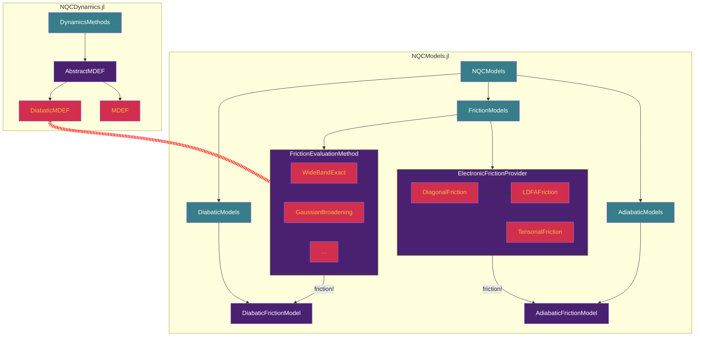
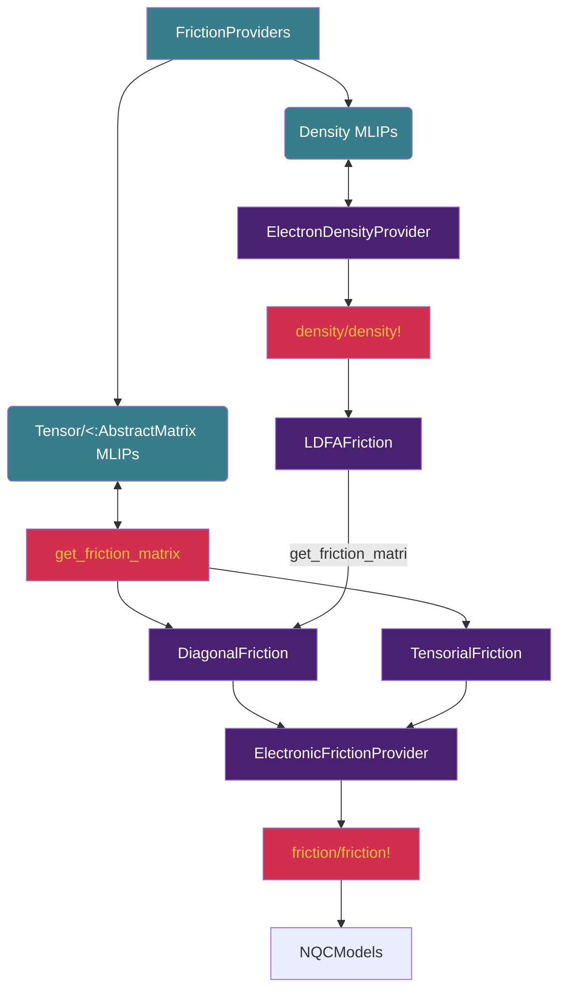

# Issue

**Title:** Re-organise friction types and code structure

## Description

# Goals
- For Adiabatic simulations: Clearer separation between friction methods (Diagonal and tensorial electronic friction) and MLIP interfaces to predict electronic friction. 
- Updated documentation pages and code comments to indicate unit requirements for electronic friction. 

# Concepts
## Unifying Adiabatic and Diabatic friction structure

## Re-shuffling code between FrictionProviders.jl and NQCModels.jl for adiabatic friction

@Ash-Baldwin is working on the Diabatic side of this while I tackle the Adiabatic side. Our idea is to have a consistent implementation of calculating non-adiabatic coupling across Adiabatic and Diabatic methods. This will make things easier to understand for users, and allow friction evaluation outside of the dynamics workflow, which is currently very difficult for Diabatic models.

## Associated tasks
This has a bunch of associated issues and PRs for different packages. 

- [ ] Fix #384 
- [ ] Fix #378 
- [x]  
- [x] Depends on 
- [x] Fix 
- [x] Fix 
- [x] Fix 
- [x] Depends on

## Task

Modify the repository so that the issue described above is resolved. The repository is checked out at base commit `62aa5895afaa`. Edit files in place; the verifier captures your changes via `git diff` and scores them against an oracle patch using SWE-RL-style diff-similarity reward.