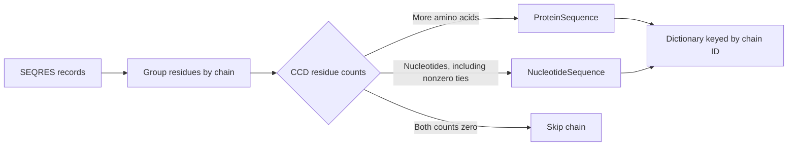

# Issue

**Title:** Parse SEQRES records for PDBFile.get_sequence()

## Description

`PDBFile.get_sequence()` extracts protein and nucleotide sequences from `SEQRES` records, with residues absent from atom coordinates.
`pdb.get_sequence()` exposes the same method through a module wrapper.
The method returns a dictionary with chain IDs as keys and `ProteinSequence` or `NucleotideSequence` values.

Residue conversion uses CCD group membership and one-letter codes, as in `to_sequence(..., allow_hetero=True)`.
Unknown residues use `X` or `N`. Uracil becomes thymine, and inosine uses `N` because the nucleotide alphabet excludes `I`.
The method skips chains outside the peptide and nucleotide groups.
Without `SEQRES` records, the method returns `{}`. An exception is the alternative.

`GTP` uses `N` despite the CCD code `G`. The parity test excludes `4gxy` for this difference.
The alternative uses every available code to reduce the difference from PDBx.

Tests in `tests/structure/io/test_pdb.py` cover the known `5ugo` sequences, 18 paired PDB/PDBx fixtures, and all four CCD nucleotide residues with code `I`.

The new sequence tests fail without the source changes and pass with them.
The PDB tests, related sequence tests, and PDB doctests pass.

.

## Task

Modify the repository so that the issue described above is resolved. The repository is checked out at base commit `2f3555289b57`. Edit files in place; the verifier captures your changes via `git diff` and scores them against an oracle patch using SWE-RL-style diff-similarity reward.